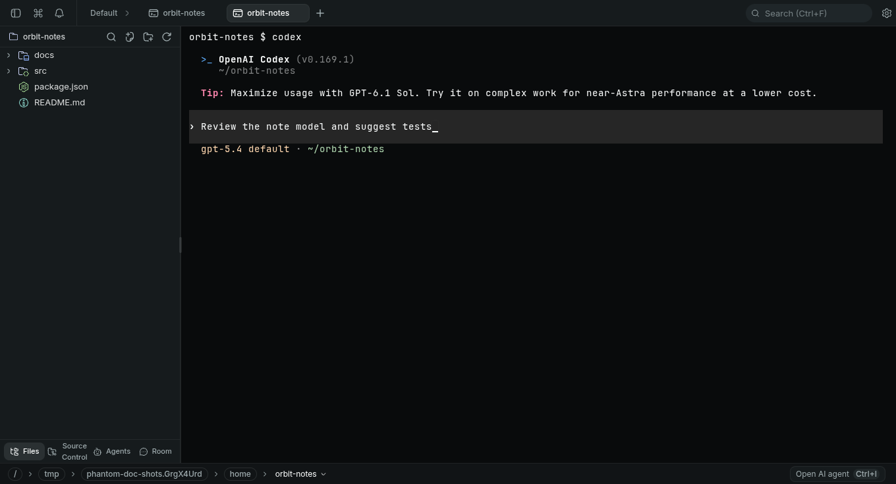
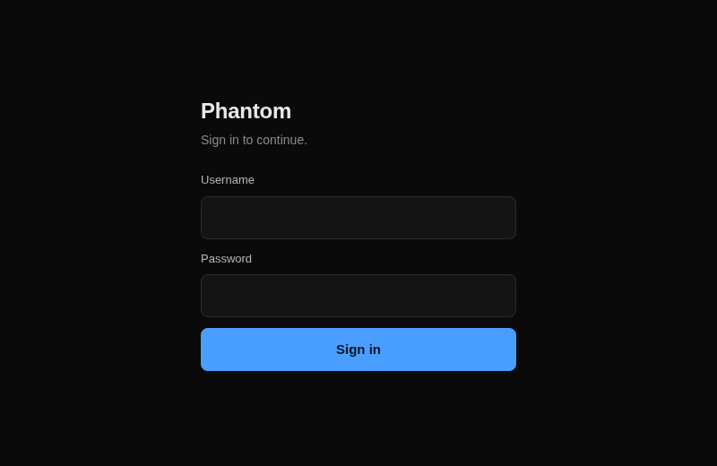
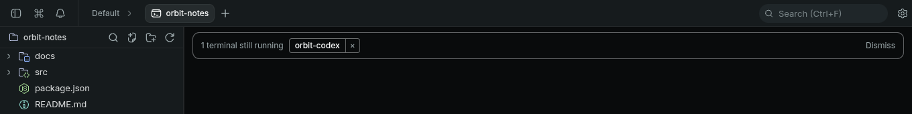

# Phantom

Phantom is an open-source, terminal-first development workspace based on
[Terax v0.9.0](https://github.com/crynta/terax-ai/tree/v0.9.0). It adds a
headless Rust gateway so you can use the workspace from a browser and
reattach to server-side rmux sessions running tools like Codex.



## What you can do

- Use split terminals, a code editor, a file explorer, Git tools, and web preview in one workspace.
- Run the workspace on a remote host with `phantom-server` and connect through a browser.
- Open an existing rmux terminal from the browser and continue using the CLI tools running on your server.
- Coordinate CLI agents in a shared Room, with messages and session status.
- Connect the AI panel to a supported provider with your own credentials or use a local model.

## Build from source

Install [Rust](https://rustup.rs/), Node.js 22 or newer, and the pnpm version
specified in [package.json](package.json). Desktop builds also require the
[Tauri platform prerequisites](https://tauri.app/start/prerequisites/).

```sh
pnpm install --frozen-lockfile
pnpm run build
cargo build --locked -p phantom-server --release
```

For desktop development, run `pnpm tauri dev`. To build a desktop bundle,
run `pnpm tauri build`.

For architecture and current integration status, see [TERAX.md](TERAX.md)
and [INTEGRATION-v0.9.0.md](INTEGRATION-v0.9.0.md). See
[CONTRIBUTING.md](CONTRIBUTING.md) for contribution and verification steps.

## Browser access over HTTPS

Use a certificate and its private key in PEM format. For local testing, run
`scripts/gen-phantom-cert.sh` to generate a certificate and key. In
`~/.config/phantom/config.yaml`, set your own username and password and
point Phantom at both files using absolute paths. Install
[rmux](crates/phantom-server/README.md#prerequisites) for the terminal backend
in this example.

```yaml
bind-addr: "127.0.0.1:8099"
auth: password
username: operator
password: "replace-with-a-long-unique-password"
cert: /home/you/.config/phantom/cert.pem
cert-key: /home/you/.config/phantom/key.pem
pty-backend: rmux
```

Run `./target/release/phantom-server` from the repository root and open
`https://localhost:8099`. Trust the local certificate on your client first.
For remote access, bind to the intended host interface and use a certificate
that the client trusts and that covers the hostname or IP in the URL.
See the [server setup guide](crates/phantom-server/README.md#https-with-a-custom-login)
for environment overrides, password hashes, and certificate options.



## Use Codex in a server-side terminal

Install [rmux](crates/phantom-server/README.md#prerequisites) and your CLI tools
on the server. With `pty-backend: rmux`, open a terminal in Phantom and run
`codex`, or reattach to a detached rmux session you started on the server.
In the browser, choose the session from the **Reattach** section of the
new-tab menu. Closing the browser leaves the session running on the server.
Use your CLI's own sign-in flow on the server. Phantom's username and password
control access to the browser workspace.



## Upstream and acknowledgments

Phantom is an independently maintained fork of [Terax](https://github.com/crynta/terax-ai).
Terax provides the foundation for the terminal, editor, file explorer, Git
interface, and AI workspace. Phantom extends that foundation with
`phantom-core`, the browser and WebSocket gateway, persistent remote PTYs,
and Room-based agent collaboration.

Thank you to [crynta](https://github.com/crynta) and the Terax contributors
for building Terax and sharing it as open source. For official Terax
releases and documentation, see the [upstream repository](https://github.com/crynta/terax-ai)
and [Terax documentation](https://terax.app/docs).

## License

Phantom is distributed under the [Apache License 2.0](LICENSE), except
where files or components identify their own licenses. See [NOTICE](NOTICE)
for upstream attribution and the licenses of bundled terminal components.
