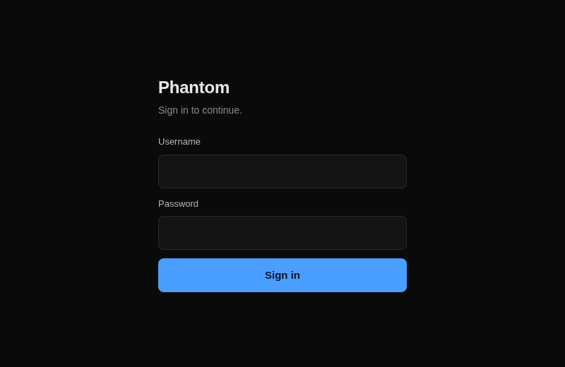

# phantom-server

The headless half of **Phantom** — a WebSocket gateway that serves the Phantom
web UI and runs terminals, files, git, the AI panel, and the multi-CLI
orchestrator on a remote host, reached from a browser (phone / AR glasses / any
device). It reuses your existing **code-server** TLS cert + password, so a box
already running code-server needs no new setup.

## Prerequisites

1. **rmux** (recommended, enables session persistence across restarts and reconnects):

```bash
cargo install --git https://github.com/helvesec/rmux --rev b9b6b86e87792ad28bcdb3815ff08cce22400bb1 rmux
```

Make sure `~/.cargo/bin` is in your `PATH`. Without rmux, Phantom falls back to `pty-backend: local` (in-process PTY via portable-pty), but terminals die when the server stops or restarts.

## Build

Two artifacts: the web UI (`dist/`) and the server binary.

```bash
# from the repo root
pnpm install           # first time only
pnpm run build         # tsc && vite build -> dist/

cargo build -p phantom-server --release   # -> target/release/phantom-server
# (drop --release for a faster debug build -> target/debug/phantom-server)
```

Rebuild `dist/` after any frontend change and the binary after any Rust change.
The running server serves `dist/` from disk, so a fresh `npm run build` is picked
up without restarting; a new binary needs a restart.

## Run

Run **from the repo root** (the web root defaults to `./dist`):

```bash
NO_PROXY=127.0.0.1,localhost,<your-brain-host> \
  env -u CLAUDE_CODE_CHILD_SESSION \
  ./target/release/phantom-server
```

Open the configured address and sign in with the credentials described below.

### Configuration

Phantom reads the file named by `PHANTOM_CONFIG`. When that variable is unset,
it reads `$XDG_CONFIG_HOME/phantom/config.yaml`, with `~/.config` as the default
configuration directory. An existing code-server config can fill unset fields.

#### HTTPS with a custom login

Create the configuration directory and generate a local certificate from the
repository root. If you already have a certificate and private key, use those
paths in the YAML.

```sh
phantom_config_dir="${XDG_CONFIG_HOME:-$HOME/.config}/phantom"
mkdir -p "$phantom_config_dir"
scripts/gen-phantom-cert.sh "$phantom_config_dir"
```

Save the following as `config.yaml` in that directory. Replace the example
credentials and the certificate paths. The generator prints the actual paths.

```yaml
bind-addr: "127.0.0.1:8099"
auth: password
username: operator
password: "replace-with-a-long-unique-password"
cert: /home/you/.config/phantom/cert.pem
cert-key: /home/you/.config/phantom/key.pem
pty-backend: local
```

```sh
chmod 600 "$phantom_config_dir/config.yaml"
PHANTOM_CONFIG="$phantom_config_dir/config.yaml" ./target/release/phantom-server
```

With the certificate trusted by the client, open `https://localhost:8099`
and sign in. For remote access, replace the loopback address with the IP of
the intended server interface and visit a hostname or IP covered by the
certificate. Use `pty-backend: rmux` if you have installed rmux and want
terminal sessions to persist across reconnects.



The login form requires the configured `username` and password. An omitted
username gives password-only login unless inherited from code-server.
Use an Argon2 PHC string in `hashed-password` to store a hash in YAML.
Password precedence is `PHANTOM_PASSWORD`, then `hashed-password`, then
`password`. The environment also accepts `PHANTOM_USERNAME`, `PHANTOM_CERT`,
and `PHANTOM_CERT_KEY` as overrides.

#### Reattach to a running CLI

Set `pty-backend: rmux` and make sure `rmux` and your tools are on the server's
`PATH`. Start a session on the server as the same OS user who runs
`phantom-server`, using the same rmux socket and a name starting with
`phantom-`.

```sh
cd /path/to/project
rmux new-session -s phantom-project-codex
codex
```

Detach with `Ctrl+b`, then `d` (the default rmux binding). Sign in to Phantom
from your browser and select `project-codex` under **New tab > Reattach**.
You can also run `codex` directly in a new Phantom terminal. Authenticate
Codex on the server using its own sign-in flow.

#### TLS certificate

Set both `cert` and `cert-key` to serve HTTPS. You can use a certificate and
key issued for your domain, reuse a suitable code-server certificate, or
generate one locally.

```bash
scripts/gen-phantom-cert.sh            # writes cert.pem + key.pem to ~/.config/phantom
```

The cert covers `localhost`, `127.0.0.1`, the host's global IPs (LAN and
Tailscale), and the Tailscale MagicDNS name. Configure clients to trust the
self-signed certificate, or use a certificate issued by a trusted CA.
For clients on multiple devices, see the CA option below. A trusted HTTPS
connection also lets the UI use clipboard, notification, and service worker APIs.

If the browser shows **Not Secure** at an `https://` address, inspect its
certificate error. For a private CA, import only `ca.pem` into the client
device's trusted root store. Check that the exact hostname or IP in the URL
appears in the certificate's Subject Alternative Names. Reissue the certificate
if that address is missing or the certificate has expired.

#### A certificate authority for several machines

One self-signed certificate has to be installed on every machine that talks to
that host, and reinstalled whenever it changes — when it expires, or when the
hub moves to a different box. A CA is worth it for the second reason more than
the first: each machine trusts the root once, and every certificate issued from
it afterwards is accepted with no further visits.

```bash
scripts/gen-phantom-ca.sh     # once, on one machine; keep ca-key.pem there
scripts/gen-phantom-cert.sh   # on each host — signs from the CA if it finds one
```

`gen-phantom-cert.sh` self-signs exactly as before when there is no CA, so an
existing single-machine setup is unaffected.

Then trust the root everywhere. A browser can be clicked through; a Tauri
webview cannot, so on macOS this is the only way the desktop app connects at all:

```bash
# macOS
sudo security add-trusted-cert -d -r trustRoot \
  -k /Library/Keychains/System.keychain ca.pem
# Arch
sudo cp ca.pem /etc/ca-certificates/trust-source/anchors/phantom-ca.crt
sudo trust extract-compat
# Debian / Ubuntu
sudo cp ca.pem /usr/local/share/ca-certificates/phantom-ca.crt
sudo update-ca-certificates
```

The OS trust store is not the whole story, because not every path through this
server reads it. Name the root in the config as well:

```yaml
room:
  ca: /home/you/.config/phantom/ca.pem
```

`say` needs it: it trusts the host certificate directly, and a CA-signed leaf no
longer validates as its own anchor — the day a CA is introduced, `say` stops
working without this line. The peer link uses it too, as the default when
`hub.ca` is not set, which is what lets the hub move without editing every peer.

#### Serving over a Tailscale tailnet

Bind to the host's own Tailscale IP so only tailnet peers can reach it, with no
firewall rule to maintain:

```yaml
bind-addr: "100.x.y.z:8099"   # from `tailscale ip -4`
```

`0.0.0.0` also works but then LAN and any public interface can reach the port
too. Regenerate the cert after joining a tailnet so the MagicDNS name and
`100.x.y.z` land in its SANs (`scripts/gen-phantom-cert.sh` picks them up
automatically).

With a default-deny host firewall (ufw's `DEFAULT_INPUT_POLICY=DROP`, firewalld,
etc.) inbound tailnet connections are dropped even though the socket is bound to
the Tailscale IP. Allow the interface once:

```bash
sudo ufw allow in on tailscale0 to any port 8099 proto tcp
```

### Environment variables

| Var | Why |
| --- | --- |
| `NO_PROXY` | **Must** include `127.0.0.1,localhost` or local model servers (Ollama/LM Studio) get proxied and 503. Also add your orchestrator **brain endpoint host** (e.g. `ark.cn-beijing.volces.com`) so a domestic API is reached direct instead of through a flaky forward proxy. |
| `PHANTOM_CONFIG` | Override the config path. |
| `PHANTOM_WEB_ROOT` | Override the web root (default `dist`). |
| `PHANTOM_ROOM_TOKEN` | The agent's room token, read by `phantom-server say`. Passed by environment rather than a flag so it stays out of shell history and `ps`. |
| `PHANTOM_ROOM_URL` | Base URL `say` posts to. Defaults to this host's own configured bind address. |
| `PHANTOM_ORCHESTRATOR_KEY` | Fallback orchestrator API key when neither the Models-panel provider nor the `orchestrator/apiKey` secret is set. |
| `CLAUDE_CODE_*` | **Unset these before launching** (or don't launch from a Claude Code shell). Inherited into spawned sessions, a `claude` run there sees `CLAUDE_CODE_CHILD_SESSION` and won't persist. The injected shell rc strips them too, but a clean launch is the belt to that suspenders. |

### One-liner used in development

```bash
# strip every CLAUDE_CODE_* the shell carries, keep the brain host off the proxy
UNSET=$(for v in $(env | grep -oE '^CLAUDE_CODE_[A-Z_]+'); do printf ' -u %s' "$v"; done)
env $UNSET NO_PROXY=127.0.0.1,localhost,ark.cn-beijing.volces.com \
  ./target/debug/phantom-server
```

## The room

A shared message log that you and the CLI agents all post into — across
machines.

The orchestrator hands work between agents through `.phantom/handoff/*.md` and
pokes them with `nudge`. Both assume one filesystem, i.e. one host. The room
lifts *who is doing what, and who needs whose output* onto a log every
participant can see, so the same workflow spans boxes: `claude` on one machine,
`agy` on another, `opencode` on a third.

Three rules shape everything below:

- **Messages carry references, not content.** A reference names a handoff file;
  the receiver reads it with its own file tools. There is deliberately no
  arbitrary-path reference — that would hand every machine on the mesh a remote
  file read.
- **Mentioning an agent sends a message to its terminal session.** Room uses
  the agent's hook state to decide when and how to submit it.
- **No new daemon.** Every box already runs a `phantom-server`; one of them
  hosts the room (the *hub*) and the others dial into it (*peers*).

Open it from the **Room** tab in the sidebar rail.

### Single machine

Nothing is required — the room works out of the box with `main` as its name and
`local` as the peer name. Add a `room:` block only to let agents post into it
(see [Letting agents speak](#letting-agents-speak)).

### Across machines

One host is the hub. It owns the log and assigns sequence numbers; everyone else
mirrors it.

```yaml
# hub — the box that hosts the room
room:
  name: main
  peer: alpha                    # this box's name in the room; unique per mesh
  workspace: /srv/project        # where its handoff files live (see below)
  agent-tokens:
    claude: <random>
  peer-tokens:                   # who may join, and as what
    b: <random>
```

```yaml
# peer — every other box, using the token the hub issued it
room:
  peer: b
  workspace: /home/you/project
  agent-tokens:
    agy: <random>
  hub:
    url: wss://192.0.2.5:8099/room/ws
    token: <random>
    ca: /path/to/the-hubs-cert.pem   # only for a self-signed hub
```

`workspace` exists because a peer has no browser to tell it which folder is
open: it is the root whose `.phantom/handoff/` is shared with the room, and
whose `.phantom/room-cache/` fetched remote files are written into. Leave it
unset and the box can still talk, but it cannot share or receive files. It is
also where each box's `agents.yaml` is read for the room's directory: the hub
tells every peer who is on every machine, so any browser — on the hub or on a
peer — offers every machine's agents for mentions. Set it on the hub too, or
the hub's own agents are missing from what peers see.

#### A machine that only hosts agents

A box whose job is to lend its agents to someone else's room has no use for the
editor, the terminal surface, or a login form, and no reason to be reachable
from the network. Add `peer-only` and it serves none of that:

```yaml
room:
  peer-only: true
  peer: b
  workspace: /home/you/project
  agent-tokens:
    claude: <random>
  hub:
    url: wss://192.0.2.5:8099/room/ws
    token: <random>
    ca: /home/you/.config/phantom/hub-cert.pem
```

No `password`, no `web-root`, no certificate of its own — the whole web surface
is gone (`/`, `/login`, `/ws`, `/blob` all 404). One loopback listener remains,
carrying `POST /room/post` and nothing else, because that is how the box's own
agents answer. It is bearer-authenticated exactly as on a full server: loopback
is not treated as trusted. The port comes from `bind-addr`, but the address is
pinned to `127.0.0.1` whatever that says.

Everything else the peer does — joining, receiving mentions, serving reference
fetches — rides the connection it dials out to the hub. `rmux` is still
required: that is where the agent sessions live.

`ca:` is the hub's certificate, copied from that machine. A self-signed cert —
what `gen-phantom-cert.sh` issues — chains to no system root, so without this the
link fails the handshake with `UnknownIssuer`. Trusting that one file is narrower
than skipping verification: the hub still has to present it. Omit `ca:` when the
hub serves a certificate a public root already covers.

Setting `hub:` is what makes a server a peer. It dials out, announces the agents
in its `.phantom/agents.yaml` and which of them are running (again whenever that
changes), and reconnects on its own with capped backoff; a peer that was away is
replayed what it missed on the way back in, so a flaky mesh link doesn't punch a
hole in its log. Generate every token with `openssl rand -hex 32`.

While its link is down, a peer refuses posts instead of numbering them itself —
a locally numbered message would collide with the hub's numbering. The browser
shows the message as not sent and keeps the draft; `say` exits non-zero. The
hub pings every peer every 20 s and each side drops a link that has been silent
for a minute, so a laptop that slept or a route that vanished is noticed and
redialed rather than looking connected. Run the same build on the hub and its
peers: an older hub does not ping, and a newer peer redials it after every quiet
minute.

### Talking

Address a participant by name. A bare `@claude` means an agent on the box you
are posting from; `@b/agy` names one on peer `b`.

```
@b/agy the API is settled, take it from here
```

Each agent chip above the input shows whether a mention will land: idle,
working, waiting for someone, CLI exited (its session is at a shell prompt, and
messages to it are refused until it is started again), or not running. Peers
report their agents' state along with their roster. A line under the
conversation names whoever is working right now, and whoever is waiting for
someone to answer them; for a minute and a half after you mention someone the
room checks every few seconds instead of every fifteen — so you see the work
get picked up, not just eventually done.

Tap a name in that line to see the agent's screen: what its terminal shows,
read-only, refreshing every few seconds — the way to see what it is doing, or
what it is asking, from a phone or another machine. A machine shows its agents'
screens only if it opts in:

```yaml
room:
  peek: true
```

It is off by default because a terminal can show code, file contents, even
secrets. The one exception is someone logged in to that machine's own web UI,
who could open the terminal anyway.

An agent that isn't running can be started by the mention itself. Add
`auto-start` on the machine that owns it:

```yaml
room:
  workspace: /home/you/project
  auto-start: true
```

A mention of an agent declared in that workspace's `.phantom/agents.yaml` then
creates its session if there is none, or starts its CLI again if the session is
back at a shell prompt, waits for the CLI to take over the terminal, and
delivers. Only declared agents are started, and only with their configured
`cmd` — nothing from the message is ever typed into the shell. It is off unless
set, because it lets any machine in the room start processes on this one, on
this machine's subscriptions.

Each agent gets its messages **in the order they were sent**. While the
`codex` agent is working, Room uses the Codex CLI's default Tab binding to
queue the message as a follow-up. Other agents receive their next message
when their hooks report idle. While an agent awaits an approval, Room waits
before sending any input. If an agent stays unavailable for 10 minutes,
Room posts a delivery notice. Messages to an agent without hooks are spaced
a few seconds apart.

A mention that can't be delivered does not fail silently. The server that
found out — the one running the agent, or the hub for a machine that isn't
connected — posts a **notice** into the room, shown as a grey line, so you learn
it wherever you asked from. Notices are never delivered to anyone.

Attach a handoff file with the **+** button. The message carries the reference;
the peer that owns `agy` fetches the file, writes it to
`.phantom/room-cache/alpha/api.md` on *its* disk, and injects a line naming that
local path. The agent is handed a path that exists on its own machine and never
has to know the room exists.

### Letting agents speak

An agent posts with its own bearer token from `agent-tokens`. One token per
agent, not one shared one: the token *is* the agent's identity in the room.

```bash
PHANTOM_ROOM_TOKEN=<the agent's token> \
  phantom-server say "@alpha/claude playwright is green"
```

or, from anything that can make an HTTP request:

```bash
curl -X POST http://127.0.0.1:8099/room/post \
  -H "Authorization: Bearer <the agent's token>" \
  -H 'content-type: application/json' \
  -d '{"text":"build is red","refs":[{"kind":"handoff","peer":"alpha","file":"error.md"}]}'
```

Both hit the same endpoint. Teach a CLI the one-liner (a hook, a skill, a
`CLAUDE.md` note) and it can report into the room on its own.

To hand back a result rather than a sentence, attach a file from this machine's
`.phantom/handoff/` — whoever is mentioned gets it copied onto their own machine:

```bash
phantom-server say "@alpha/claude the report is ready" --ref report.md
```

`--ref` may repeat. The server checks the file exists before posting, and a
refusal comes back with its reason (`no such handoff file …`), so an agent can
correct itself instead of believing the message landed.

### Getting an answer back

Delivery would otherwise be one-way. An agent reads the injected message, does
the work, and answers in its own terminal — where nobody in the room sees it.
"remember to report back" does not help, because the agent has no idea the room
exists.

Two things close the loop, and neither needs anything from the agent's side:

- Every agent session this server creates carries `PHANTOM_ROOM_TOKEN` and
  `PHANTOM_ROOM_URL` in its **environment**, so `say` works with no arguments
  and no token in the command. A token in argv would land in shell history, in
  `ps`, and in the agent's own scrollback.
- Every injected message ends with the exact command to answer with. Agents keep
  no memory of the room between messages, so it rides along each time rather
  than being explained once.

Agents that can answer can also answer each other, indefinitely — two polite
agents will thank each other forever, on their owners' subscriptions. So after
**10 agent-to-agent handoffs in a row with no person in between**, the hub stops
delivering agent mentions and posts a notice saying so. The messages are still
logged; anyone mentioning an agent themselves hands control back.

An agent with no entry in `agent-tokens` is still addressable; it just gets no
hint, since telling it to run a command that would 401 is worse than silence.

**Sessions created before this existed do not have the variables.** Kill the
session and open it again to pick them up.

`say` posts to this host's own configured address unless `PHANTOM_ROOM_URL` says
otherwise, and trusts the certificate named by `cert:` in addition to the system
roots — otherwise it would fail against the self-signed setup above, which is
the one this README recommends. That is narrower than skipping verification: an
impostor still has to present that exact certificate.

### Asking the room's own assistant

A device with no AI tools of its own — a phone, a borrowed laptop — can still get
work done in the room: name a built-in assistant, and mentioning it is answered
by a model on this server instead of by a CLI agent.

```yaml
room:
  assistant:
    name: ai                 # mentioned as @ai (or @alpha/ai from another machine)
    model: glm-4.6
    # endpoint: https://…/chat/completions   # any OpenAI-compatible URL; GLM's by default
```

The API key is the orchestrator's: the `orchestrator/apiKey` secret, else
`PHANTOM_ORCHESTRATOR_KEY`. Leave out `model` and the `orchestrator:` block of
`workspace`'s `agents.yaml` is used, so a machine that already has a brain set up
only needs the name.

The model sees the last 20 messages before the question and the text of any
handoff files attached to it, fetched from whichever machine owns them. Its
answer is posted as `<peer>/<name>`. It is listed with the agents, so every
machine offers it for mentions, and shows as working while it answers. If it can't answer (no key, the endpoint down),
a notice says why.

### Connecting a client from another machine

A device that only wants the chat — a phone, a laptop, the desktop app — joins
at `GET /room/client` with a token of its own:

```yaml
room:
  client-tokens:
    sams-mac: <random>
```

This is a **third** class of credential, and the separation is the point. The
login password reaches a shell through `/ws`; handing it to every device that
wants to read the room would mean handing out the machine. A client token
reaches `room_post`, `room_history` and `room_roster`, and nothing else —
`pty_open`, `fs_read_file` and the rest are not merely refused there, they do
not exist on that surface.

Authentication is the **first frame**, not a header: a browser's WebSocket API
cannot set `Authorization`, and Tauri's frontend is a browser. A token in the
URL would land in server logs and browser history.

```jsonc
// client → server, immediately on open
{"type": "auth", "token": "…"}
// server → client, once accepted (otherwise the socket just closes)
{"type": "ready"}

// thereafter, the same request/response shape the browser socket uses
{"type": "invoke", "req": 1, "cmd": "room_history", "args": {}}
// a post may carry text to keep as files here and reference from the message
{"type": "invoke", "req": 2, "cmd": "room_post",
 "args": {"text": "@ai what broke?", "attach": [{"name": "build.log", "text": "…"}]}}
{"type": "result", "req": 1, "ok": {"room": "main", "messages": []}}
// and pushed as messages arrive
{"type": "event", "event": "room:event", "payload": {"kind": "message", "message": {…}}}
```

#### From a phone

Any browser can join at `https://<host>:<port>/room` — no app, no login. The
page asks for a client token once, keeps it on that device, and is the room and
nothing else: messages, the agents and the assistant to mention, and a box to
write in. It is served without the login on purpose: it holds no secrets and
does nothing until given a token, and the login it would otherwise need is the
one that reaches a shell. "Sign out" forgets the token.

📎 attaches text files — a log, notes, a config — and anything pasted that is
too long for a message goes as a file on its own, keeping its first line as the
message so an `@mention` there still routes. Attachments are kept on the server
the device is connected to, under `.phantom/handoff/room/`, and travel like any
other handoff file: every mentioned agent and the assistant can read them. That
server needs `room.workspace`. The desktop app's Room panel has the same 📎,
for the same reason: when it talks to a hub on another machine, a file on the
desktop is not somewhere the room can read.

Since this is the one thing a client token can write, it is fenced: text only,
at most 4 per message and 64 KiB each, names reduced to one plain file name
that never replaces an existing file, and 50 MiB in total before the folder
refuses more — clear it to make room.

A connected client is pinged every 20 s (a browser answers on its own) and sent
a small `{"type":"keepalive"}` it can see, since a page's script never sees
pings. Either side that hears nothing for a minute takes the connection for
dead: the server drops it, and the page and desktop app reconnect — so a phone
that slept doesn't sit on a socket that only looks open.

A client posts as the human at the server it connects to. The room has no
per-person identity, so two devices on the same hub are indistinguishable in the
log — the token names the device for the server's own audit line, not for
anybody reading the chat.

### Security

- Three separate credentials, none of which substitutes for another: the login
  password (the web UI, and through it a shell), agent tokens (an agent's
  identity when posting), and client tokens (the room, read and write, nothing
  else).
- Every token is the whole of what guards what it opens. Generate them with
  `openssl rand -hex 32`; the server warns at startup about any shorter than
  16 characters.
- Tokens live in the server's config file and nowhere else. They are never sent
  to a browser, which authenticates with its session cookie as before. Keep the
  config `0600`.
- A peer can read exactly one thing from another box: files inside that box's
  `.phantom/handoff/`, through the same traversal guard the orchestrator's
  `read_handoff` tool uses. Nothing else on that filesystem is reachable, and a
  reference is refused outright if it names a box other than the one serving it.
- Inbound peer posts are rate-limited, so one compromised box on the mesh cannot
  flood the log or wedge every agent with injections.
- A message is only ever typed into an agent's **CLI**, never into its shell.
  An agent session is a login shell with the CLI started inside it; once the CLI
  quits, the shell is what is left, and typing a message there would run it as
  a command on that box for anyone who can post. Delivery checks the pane's
  foreground process (and the hook tracker's record of the CLI exiting) and
  refuses instead — start the agent again to receive messages.
- Control characters in a message become spaces before injection, so text can
  never act as keystrokes (ending a bracketed paste, pressing Enter early).
- A reference must name a peer, not a path: the fetched copy is written under
  `.phantom/room-cache/<peer>/`, and a relayed `../..` would otherwise write
  wherever the receiving user can.
- The room rides the same listener as everything else — bind to the tailnet IP,
  serve TLS, and it inherits both.

### Limits

- **Messages are short.** At most 8 KiB of text and 16 references, on every way
  in — the browser, `say`, a room client, a peer. Anything longer belongs in a
  handoff file the message references.
- **Blob references don't cross machines.** The peer frames are text; a 32 MB
  screenshot does not belong in one. Handoff (text) references cross fine.
- **No MCP tools yet.** `phantom-server` has no MCP surface, so there is nothing
  to hang `room_post` on. `say` and the HTTP endpoint cover the same ground.
- The log lives at `~/.local/share/phantom/rooms/<name>.jsonl` — one line per
  message, `tail -f`-able while debugging a handoff. Beside it, `<name>.epoch`
  names that log. Numbers start again whenever a log does — renaming the room,
  deleting the file, moving the hub to another box — and the epoch is how
  everyone notices: a peer sets its old copy aside as `<name>.<epoch>.jsonl` and
  mirrors the new log from the start, and an open client starts over instead
  of mixing the two histories. Two servers on the *same*
  box need different `room.name` values or they share the file.

## Notes

- Sessions live in memory: restarting the server logs users out (they must
  re-login; a stale cookie dead-loops on reconnect).
- The desktop Tauri build is unverifiable on a headless box (no webkit2gtk);
  changes here are tested against the server + web UI, not the desktop app.
- The multi-CLI orchestrator, its config (`.phantom/agents.yaml`), and the
  agent workflow are documented in the repo's `Phantom-任务清单.md` §二 P1.
- The room reuses that same `.phantom/agents.yaml` for its roster, so an agent
  the orchestrator knows about is mentionable without extra setup.
